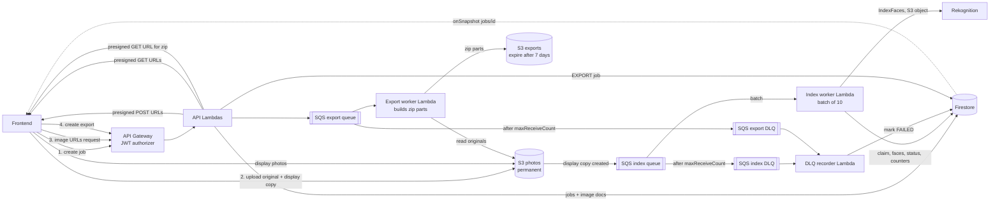
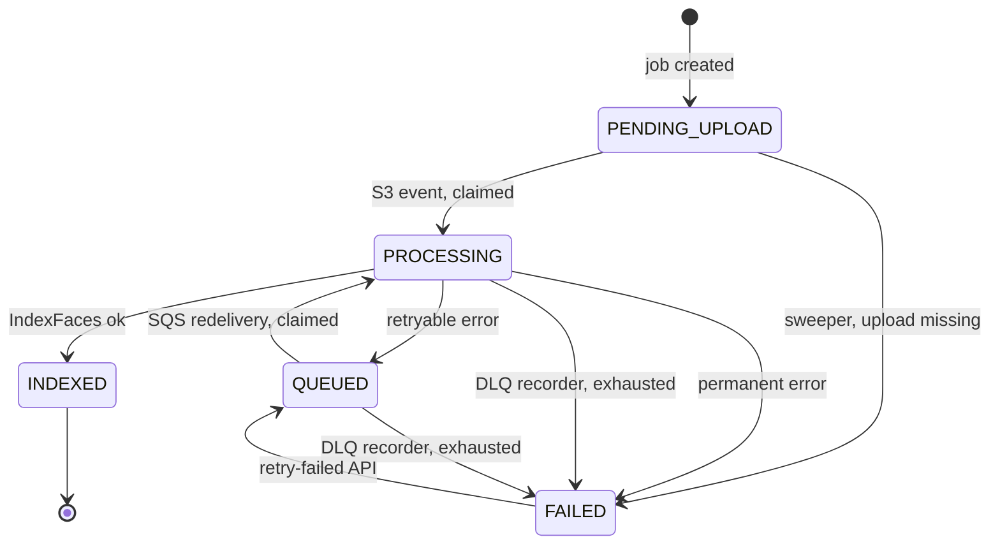

# Serverless refactor plan (AWS)

Move the Ktor server to S3, SQS, Lambda and Rekognition, with Firestore as the source of truth for results and progress. Photos are stored permanently in S3, the browser displays them through URLs returned by the API, and grouped photos are downloaded as zip files built on Lambda. This document is a plan only. No code has changed.

Scope in order of priority:

1. Photo storage and the indexing pipeline: S3 upload, SQS, batched Lambda, Rekognition `IndexFaces`.
2. Failure handling: classified errors, SQS retries, a dead-letter queue, and a way to retry failed images.
3. Viewing results: image URLs from the API, categorize as a job instead of an SSE stream.
4. Downloading grouped photos: a zip export job.
5. Move the remaining endpoints (collections, billing, webhooks) to Lambda.

## 1. Goals and non-goals

Goals:

- Results no longer depend on the user's local folder. A user can open a collection months or years later and see and download their photos, in any browser.
- Every photo is identified by a stable `imageId`. Filenames are display metadata only and are never used for lookups.
- Billed time goes to work, not waiting. No `delay()` rate-limit sleeps, no open SSE connection, no per-person Firestore round trips.
- Every uploaded image ends in exactly one terminal state (`INDEXED` or `FAILED`) that the user can see, and failed images can be retried.
- A Lambda invocation handles a batch of up to 10 images and makes a fixed, small number of Firestore transactions regardless of batch size.
- Rekognition request rate stays under the account quota by configuration, not by sleeping.

Non-goals (for now):

- Changing the clustering algorithm beyond reading faces from Firestore instead of `ListFaces`.
- Replacing Firestore or Firebase Auth.
- Multi-region.

## 2. Target architecture



Flow for an upload:

1. The frontend creates a display copy of each photo in the browser (JPEG, long edge about 1600 px, under 5 MB) and calls `POST /collections/{collectionId}/jobs` with the file list.
2. The API Lambda checks ownership and subscription, creates `jobs/{jobId}` and one `images/{imageId}` document per file, and returns two presigned POST forms per image: one for the original, one for the display copy.
3. The frontend uploads the original first, then the display copy, and watches `jobs/{jobId}` with `onSnapshot`.
4. S3 emits an `ObjectCreated` event only for the display copy into the index queue.
5. The index worker pulls up to 10 messages at a time, indexes the display copies with Rekognition, and writes results.
6. Messages that exhaust their retries land in the DLQ. A recorder Lambda marks those images `FAILED` so the job can finish.
7. The user can call `POST /jobs/{jobId}/retry-failed` to re-queue failed images that can plausibly succeed.

Flow for viewing and downloading:

1. After categorizing, the frontend loads the result from Firestore (person ids, image ids, filenames, thumbnail boxes).
2. It requests presigned image URLs from the API in pages as the user scrolls and renders the photos directly from S3.
3. To download, the user creates an export. A worker builds zip parts into the exports bucket, and the frontend downloads them from presigned URLs.

## 3. Components

### 3.1 S3 buckets

`photos` bucket (permanent):

- Key layout: `users/{ownerId}/{collectionId}/{imageId}/original` and `users/{ownerId}/{collectionId}/{imageId}/display.jpg`. Keys are generated by the server. The original filename is never part of the key.
- The owner id is in the path so one prefix delete removes everything for a user or a collection.
- Presigned POST with a `content-length-range` condition (display copy: the 5 MB Rekognition limit; original: a configurable maximum), a fixed `key`, and a 15 minute expiry.
- Public access blocked, default encryption on, versioning off. Lifecycle: abort incomplete multipart uploads after 1 day. No expiration for photos.
- CORS allows POST from the frontend origin.
- Event notification: `s3:ObjectCreated:*` with suffix `/display.jpg` to the index queue. Originals do not trigger anything.
- Upload order is a rule the frontend follows: original first, then display copy. The display copy's arrival means the original is already in place. The worker still checks for the original (3.3) as a guard.

`exports` bucket:

- Key layout: `exports/{ownerId}/{jobId}/part-{n}.zip`.
- Public access blocked. Lifecycle expires objects after 7 days.

### 3.2 SQS

Index queue (standard; S3 cannot publish to FIFO):

| Setting | Value | Why |
|---|---|---|
| Visibility timeout | 6 x worker timeout | AWS guidance for Lambda event sources |
| Redrive policy | `maxReceiveCount` 5, dead-letter queue | Bounded retries |
| Message retention | 4 days (default) | Covers a long outage |

Index DLQ: retention 14 days, alarm on any message that stays longer than a few minutes, since the recorder normally drains it immediately.

Two message shapes are accepted by the index worker:

- S3 event notification (normal path). Parse the key, skip `s3:TestEvent`, URL-decode the key (spaces arrive as `+`).
- Internal message `{ "type": "INDEX" | "ATTACH", "jobId": "...", "imageId": "..." }` sent by the retry API and the legacy attach flow (section 10).

Categorize and export each get their own queue and DLQ (sections 8 and 3.9), so the workloads have separate concurrency caps and alarms.

### 3.3 Index worker Lambda

Event source mapping:

| Setting | Value | Notes |
|---|---|---|
| `BatchSize` | 10 | Maximum for a standard queue without a long window |
| `MaximumBatchingWindowInSeconds` | 5 | Fills batches during large uploads; adds up to 5 s to the tail of a small upload |
| `FunctionResponseTypes` | `ReportBatchItemFailures` | Retry only the failed messages |
| `ScalingConfig.MaximumConcurrency` | derived from quota, see 3.7 | Do not use reserved concurrency for this; throttled invocations burn `maxReceiveCount` |

Function: 1024 MB, timeout 60 s, SnapStart enabled, role limited to the bucket prefix, the Rekognition collections, the queue, and the Firebase secret.

Per-invocation algorithm (the batch is up to 10 messages):

1. Parse messages into image references. Unknown keys, or keys with no matching image document: log, acknowledge, move on.
2. One Firestore transaction: read all image documents and the job documents involved, decide per image (section 4.2), write `PROCESSING` plus a lease for the ones to run.
3. For each claimed image, check that the original exists (`HeadObject`). A missing original is a retryable error `ORIGINAL_MISSING`, so a slow upload gets another chance.
4. Run `IndexFaces` for the claimed images concurrently with a semaphore of 5 (section 3.7). The display copy is passed as an S3 object, so no bytes pass through the Lambda.
5. Classify each result (section 5).
6. One Firestore transaction: write the result for every image (faces and `INDEXED`, or `FAILED`, or back to `QUEUED` with the error recorded) and apply the counter deltas to each affected job document.
7. For retryable failures, change the message visibility to a backoff (section 5.3) and report the message in `batchItemFailures`.

That is two Firestore transactions per invocation (claim and results), however many images are in the batch, instead of one write per face.

An `ATTACH` message (section 10) skips steps 3 to 5: it only verifies that both objects exist and records `storage = READY`.

### 3.4 DLQ recorder Lambda

Triggered by the index DLQ and the export DLQ (batch size 10). For each message: in a transaction, if the work item is not already in a terminal state, set it `FAILED` with `failureKind = EXHAUSTED`, keep `lastError` from the last attempt, and apply the job counter delta. Then delete the message by returning success.

For index messages the work item is an image. For export messages it is an export part. The S3 objects are still present, so the DLQ message itself has no further value. The retry API re-creates work from the Firestore documents.

### 3.5 Sweeper Lambda

Runs on an EventBridge schedule (every 15 minutes). It handles states that no queue message will ever resolve:

- `PENDING_UPLOAD` older than the upload expiry (default 1 hour): mark `FAILED` with `failureKind = UPLOAD_MISSING`.
- `QUEUED` older than a threshold with no recent attempt (for example the retry API changed state but the `SendMessageBatch` call failed): re-send the internal message.
- Jobs still `RUNNING` whose counters now add up: close them (safety net for a lost counter update).
- Export parts stuck in `QUEUED` or `PROCESSING` past their lease with no queue message: re-send.

### 3.6 API Lambdas

- API Gateway HTTP API with a JWT authorizer (issuer `https://securetoken.google.com/<firebase-project-id>`, audience the project id). Handlers receive a verified `uid`. This replaces `requireUid` and `FirebaseAuthService` on routes behind the gateway.
- New routes:
  - `POST /collections/{id}/jobs`
  - `POST /jobs/{jobId}/retry-failed`
  - `POST /collections/{id}/categorize`
  - `POST /collections/{id}/image-urls`
  - `POST /collections/{id}/exports`
  - `GET /exports/{jobId}/download-urls`
  - `DELETE /collections/{id}` (now an async cleanup job, section 3.10)
- Existing routes move over in phase 5. The Stripe webhook route has no authorizer and verifies the signature itself.
- Handlers are plain `RequestHandler` classes. Netty and Ktor are removed from the Lambda artifacts.

### 3.7 Rate limiting against Rekognition

Find the `IndexFaces` TPS quota `Q` for the region in Service Quotas, and request an increase if needed. Then:

```
calls/s  ~=  MaximumConcurrency x in-flight calls per invocation / call latency
```

Pick `MaximumConcurrency` (C) and the per-invocation semaphore (L = 5) so that `C x L / latency` stays at about 70% of `Q`. For example `Q = 50`, latency 0.7 s, L = 5 gives C of at most 4. Measure real latency in the first load test and adjust. Treat `ThrottlingException` as a normal retryable error (section 5), not as a sign the configuration is wrong, unless it is frequent.

### 3.8 Viewing photos

The browser renders photos from S3 with presigned GET URLs that the API creates. Firestore stores keys and ids, never URLs.

`POST /collections/{id}/image-urls` takes `{ imageIds: [...up to 100], variant: "display" | "original" }` and returns `[{ imageId, url, expiresAt }]`.

- The API verifies once that the caller owns the collection. The keys are built from the verified `uid`, the collection id, and the image id (`users/{uid}/{collectionId}/{imageId}/...`), so an id from another user's collection cannot resolve to someone else's object. No per-image Firestore reads are needed.
- Signing is local and does not call AWS, so 100 URLs is cheap.
- URLs expire after about 30 to 60 minutes. They are bearer links. The frontend requests fresh ones when a page is opened and refreshes on a 403.
- The frontend asks in pages as the user scrolls, and uses the `display` variant for grids. The `original` variant is only for a "view full size" action.
- Later option: CloudFront with signed cookies for one collection prefix, so the frontend can build image URLs from ids with no per-page API calls. Not needed at the start.

### 3.9 Export worker (zip files)

`POST /collections/{id}/exports` takes `{ categorizationId, personIds?: [...] }` and creates `jobs/{jobId}` with `type = EXPORT`. The frontend watches that job.

Planning: the first message on the export queue is `{ type: "PLAN", jobId }`. The worker reads the result and the image documents (which hold `originalSize`), splits the work into parts of at most about 2 GB and 1,000 files, writes `jobs/{jobId}/parts/{n}` documents, and enqueues one message per part. Parts make each unit of work small enough to finish well inside the Lambda limit, and a failed part retries on its own.

Building a part:

- Function: 2048 MB, timeout 15 minutes, `MaximumConcurrency` small (1 to 3 to start), role limited to read `photos` and write `exports`.
- For each image in the part: stream `GetObject` of the original into a `ZipOutputStream` using the `STORED` method (photos are already compressed, so deflating wastes CPU), and pipe the zip stream into an S3 multipart upload (parts of 16 to 64 MB). Memory stays bounded by the part buffer, and nothing is written to local disk. ZIP64 is used automatically for large archives.
- The object only appears when the multipart upload completes, so a crashed attempt leaves nothing visible. A retry aborts leftover uploads and writes the same key again.
- Entry names: `{person folder}/{filename}`. The folder is `Person 01`, `Person 02` and so on (renameable later). Filenames are sanitized (path separators, invalid characters, length), and duplicates within a folder get ` (2)`, ` (3)`. A photo with several people appears in each person's folder.
- Images that cannot be read (legacy images with no stored original, deleted objects) are skipped and listed in the part's `skipped` array. The job finishes with warnings. The zip is still produced.

States: each part follows the same pattern as images (`QUEUED`, `PROCESSING` with a lease, `COMPLETE`, `FAILED`), the same retry layers (section 5.2), the same DLQ recorder, and the same retry-failed API.

Completion: when all parts are `COMPLETE`, the job is `COMPLETED` and holds `parts: [{ n, key, sizeBytes, imageCount }]`. `GET /exports/{jobId}/download-urls` returns presigned GET URLs for the zip parts with `response-content-disposition: attachment` and a sensible filename. Zips are plain downloads, so they work in every browser, including Safari.

Exports expire after 7 days. The user simply creates another export.

### 3.10 Deleting data

Because photos are kept permanently, deletion is a real feature:

- `DELETE /collections/{id}` creates a cleanup job and returns 202. A worker deletes the Rekognition collection, lists and batch-deletes the S3 prefix `users/{uid}/{collectionId}/` and any exports for it, and recursively deletes the Firestore data (`images`, `jobs`, categorization results). Progress is on the job document. The existing handler deletes only the metadata and the Rekognition collection.
- Account deletion uses the same worker for `users/{uid}/`.
- The user-facing privacy statement needs to say photos and face data are kept until the user deletes them.

## 4. Firestore data model

### 4.1 Collections

```
collections/{collectionId}                  existing: ownerId, displayName, createdAt
collections/{collectionId}/images/{imageId} one document per photo (new)
jobs/{jobId}                                one document per upload, categorize, export, attach or cleanup run (new)
jobs/{jobId}/parts/{n}                      export parts (new)
categorizations/{docId}                     existing result documents
billingProfiles, accounts                   unchanged
```

`jobs/{jobId}`:

| Field | Notes |
|---|---|
| `type` | `INDEX`, `ATTACH`, `CATEGORIZE`, `EXPORT`, `CLEANUP` |
| `ownerId`, `collectionId` | For rules and queries |
| `status` | `RUNNING`, `COMPLETED`, `COMPLETED_WITH_ERRORS`, `FAILED` |
| `total`, `indexed`, `failed` | Counters for `INDEX` and `ATTACH` jobs. Pending is `total - indexed - failed` |
| `parts`, `totalParts`, `completeParts`, `failedParts`, `warnings` | For `EXPORT` jobs |
| `processed`, `total`, `resultId` | For `CATEGORIZE` jobs |
| `createdAt`, `updatedAt` | Server timestamps |
| `expiresAt` | Upload deadline (index) or download expiry (export) |

A job is complete when every work item is terminal. Status becomes `COMPLETED` if nothing failed, otherwise `COMPLETED_WITH_ERRORS`.

`collections/{collectionId}/images/{imageId}`:

| Field | Notes |
|---|---|
| `jobId`, `ownerId` | Link back to the job, for rules |
| `filename` | Original name. Display metadata and the zip entry name. Never used for lookups |
| `relativePath` | Optional path inside the selected folder, to tell apart duplicate names |
| `originalSize`, `originalContentType` | From the upload request. Used to plan exports |
| `storage` | `READY` when both objects are in S3. `NONE` for legacy images (section 10) |
| `status` | `PENDING_UPLOAD`, `QUEUED`, `PROCESSING`, `INDEXED`, `FAILED` |
| `failureKind` | `PERMANENT`, `EXHAUSTED`, `UPLOAD_MISSING` when `FAILED` |
| `attempts` | Incremented on each claim |
| `leaseUntil` | Set while `PROCESSING` |
| `lastError` | `{ code, message, at }` from the last failed attempt |
| `faces` | Array of `{ faceId, confidence, boundingBox, poseDistance }` when `INDEXED` |
| `indexedAt` | Server timestamp |

S3 keys are derived from `ownerId`, the collection id and `imageId`, so they are not stored.

Faces live inside the image document. That makes indexing one write per image, lets categorize read all faces with a single query per collection, and removes the `faceDetails` writes and the `getFaceForThumbnail` query.

Photo to face mapping: the Rekognition `ExternalImageId` is the `imageId` (a UUID). This keeps the existing mechanism, but the value is a stable id that resolves to the S3 object and to the filename in Firestore, so nothing depends on filenames or on the user's disk. It also fixes two existing problems: Rekognition only accepts `[a-zA-Z0-9_.\-:]` in that field, and filenames collide across folders.

### 4.2 Image state machine



Claim rules inside the claim transaction:

| Current state | Action |
|---|---|
| `INDEXED` | Acknowledge the message (duplicate delivery) |
| `PENDING_UPLOAD`, `QUEUED` | Claim: set `PROCESSING`, `attempts += 1`, `leaseUntil = now + timeout + margin` |
| `PROCESSING`, lease still valid | Another invocation may be running. Report the message as failed so it returns later |
| `PROCESSING`, lease expired | The previous invocation died. Claim again |
| `FAILED` | Acknowledge unless the message is an internal retry message |
| Missing | Log and acknowledge |

Counter deltas are applied only at transitions between non-terminal and terminal states, computed in one helper so that no path can double count:

- Into `INDEXED`: `indexed += 1`
- Into `FAILED`: `failed += 1`
- `FAILED` to `QUEUED`: `failed -= 1`

### 4.3 Known gap: duplicate faces after a crash

`IndexFaces` is not idempotent. If an invocation dies after Rekognition indexed the faces and before the result is written, the retry indexes the photo again and leaves orphan faces in the Rekognition collection. The plan accepts this because Firestore is the source of truth:

- Categorize builds its list of faces from the Firestore `faces` arrays, never from `ListFaces`.
- `SearchFaces` matches that are not in the known face set are ignored.
- Orphans cost a negligible storage fee and disappear when the collection is deleted.

### 4.4 Counter contention

Each invocation updates its job document once, inside the result transaction. With `MaximumConcurrency` of about 4 and one write per invocation, that is a few writes per second to one document, near Firestore's sustained single-document limit. Firestore retries aborted transactions, and the writes are idempotent per image, so this is acceptable to start. If load tests show contention, switch to sharded counters (`jobs/{jobId}/shards/{n}`) and sum them in the client. The sweeper and the retry API reconcile counters from a `count()` aggregation over the images, so a drifting counter is self-correcting.

### 4.5 Security rules and indexes

- Rules: owners can read `collections`, `images`, `jobs`, `parts`, `categorizations` where `ownerId == request.auth.uid`; `billingProfiles` is read-only for the owner. All writes come from the backend (Admin SDK bypasses rules).
- Composite index: `images` on `jobId` + `status` (retry API and job views). Categorize reads `status == INDEXED` within one collection, which needs no composite index.

## 5. Error handling and retries

### 5.1 Classification

Every failure in a worker is classified before anything is written. The index worker's table:

| Class | Examples | Action |
|---|---|---|
| Success, no faces | Image has no detectable faces | `INDEXED` with an empty `faces` array. Not an error |
| Permanent | `InvalidImageFormatException`, `ImageTooLargeException`, `InvalidS3ObjectException` for a missing display copy, `ResourceNotFoundException` (collection deleted), `InvalidParameterException` | `FAILED`, `failureKind = PERMANENT`, record `lastError`, acknowledge. Never retried automatically |
| Retryable | `ThrottlingException`, `ProvisionedThroughputExceededException`, `InternalServerError`, `ServiceUnavailable`, `ORIGINAL_MISSING`, timeouts, network errors, transient Firestore errors (`UNAVAILABLE`, `DEADLINE_EXCEEDED`, `ABORTED`) | Back to `QUEUED`, record `lastError`, report in `batchItemFailures` |
| Unknown | Anything unmapped | Treat as retryable. The DLQ bounds the damage |

The export worker uses the same shape: S3 `NoSuchKey` for one image is a skip with a warning, S3 throttling, 5xx and timeouts are retryable, and a failed multipart upload retries the whole part.

The classifier is a pure function with a table-driven unit test. This is the piece most worth testing well.

### 5.2 Layers of retry

1. **SDK retries** inside one call: a small number of attempts with exponential backoff. Kept low so one slow call does not eat the invocation timeout.
2. **Message retries** via SQS: up to `maxReceiveCount` (5) deliveries per image or part.
3. **DLQ recorder**: after the last delivery the item becomes `FAILED` / `EXHAUSTED`, so the job finishes instead of hanging.
4. **User or operator retry**: `POST /jobs/{jobId}/retry-failed` for items that failed for reasons that may have passed.

### 5.3 Backoff

SQS has no exponential backoff. By default a failed message reappears when its visibility timeout runs out. For retryable failures the worker calls `ChangeMessageVisibility` with a delay that grows with `ApproximateReceiveCount` (roughly 15 s, 30 s, 60 s, 120 s, with jitter) before reporting the message as failed. The delay has to be shorter than the remaining visibility timeout.

### 5.4 Retry API

`POST /jobs/{jobId}/retry-failed`:

1. Check the job belongs to the caller and the subscription is active.
2. Select items with `status == FAILED` and `failureKind == EXHAUSTED` by default. `PERMANENT` failures are skipped unless the client passes `includePermanent: true`, because retrying a corrupt image only wastes Rekognition quota.
3. In a transaction, set them to `QUEUED`, reset `attempts`, subtract them from `failed`, and set the job back to `RUNNING`.
4. Send internal messages with `SendMessageBatch` (10 per call). Images whose objects are missing from S3 are marked `FAILED` / `UPLOAD_MISSING` and the response tells the client to re-upload them.
5. If a send fails after the state change, the sweeper re-sends (section 3.5).

### 5.5 Observability

Structured logs with `jobId`, `imageId` or part number, `attempt`, and `errorClass` on every item. CloudWatch alarms:

- Index and export DLQ age or depth.
- `ApproximateAgeOfOldestMessage` on the queues (consumers stalled).
- Worker errors and throttles.
- Rekognition throttled-request metric (signal to lower `MaximumConcurrency` or request a higher quota).

## 6. Frontend contract

- Upload: `POST /collections/{id}/jobs` returns `{ jobId, images: [{ imageId, filename, original: { url, fields }, display: { url, fields } }] }` (a page of up to 500 files; larger uploads use several jobs). The frontend sends `filename`, `relativePath` (if available), `size` and `contentType` for each file. It uploads the original, then the display copy, 6 to 10 photos at a time, and shows progress from `jobs/{jobId}` via `onSnapshot`.
- Failed images are listed from `images` where `jobId == X` and `status == FAILED`, with `lastError.code` mapped to a readable message.
- Results: the frontend reads the categorization result from Firestore. Each person has `images: [{ imageId, filename }]` and `thumbnail: { imageId, boundingBox }`. It asks `POST /collections/{id}/image-urls` for URLs in pages and shows photos with ordinary `img` tags. Thumbnails are the display copy cropped with the bounding box in CSS.
- Download: the frontend calls `POST /collections/{id}/exports`, watches the export job, then downloads each part from the URLs returned by `GET /exports/{jobId}/download-urls`.
- The user no longer re-attaches a folder. Nothing in viewing or downloading uses local files, folder access, or file-system APIs, so it works in Safari. Uploading uses standard file selection.
- The frontend creates the display copy before uploading. This also keeps every Rekognition request under its size limit. How HEIC and other non-JPEG photos are handled is an open question (section 13).

## 7. Repository changes

Backend (`face-recognition-be`):

| Today | Change |
|---|---|
| `Routing.kt` | Split into handlers. `/indexFaces` is replaced by the job routes. Keep it until cutover |
| `RekognitionService.indexFaces(bytes, filename, ...)` | Takes an S3 object reference and the `imageId`. Returns faces with pose. No Firestore access |
| `FirestoreService.saveFaceDetails` | Removed (also contains a no-op `firestore.batch().commit()`) |
| `FirestoreService.assignFaceDetailsToPerson`, `getFaceForThumbnail` | Removed. Thumbnail choice moves in memory |
| `FirestoreService.saveCategorizationResult` / `getCategorizationResults` | New person shape with `imageId` + `filename`. One document per person |
| `CategorizePhotosUseCase` | Reads faces from Firestore, not `ListFaces`. Rate limiting by queue concurrency, not `delay()` |
| `RekognitionService.listCollections` | Replaced by counters on the collection document (see phase 6) |
| `model/Person.kt` | `images` becomes a list of `{ imageId, filename }`. `Thumbnail.imageFilename` becomes `imageId` |
| `StripeParamsProvider` | Fetch at init with a TTL re-check. The background refresh coroutine does not survive Lambda freezes |
| `FirebaseAdminSdkProvider` | Keep (Secrets Manager). Cache across warm invocations |
| `build.gradle.kts` | Multi-module: `core` (models, Firestore, Rekognition, S3), `api`, `index-worker`, `export-worker`, `dlq-recorder`, `categorize-worker`, `sweeper`. Each module builds its own jar with only the dependencies it needs |
| New `infra/template.yaml` | AWS SAM template: buckets, queues, mappings, functions, schedule, alarms. Parameters for `uat` and `prod` |

Frontend (`face-recognition-fe`, to be detailed after reading that repository): remove the folder re-attach and copy logic, add the presigned upload flow with display-copy creation, job progress from Firestore, lazy image URLs, and the export download.

## 8. Categorize as a job

- `POST /collections/{id}/categorize` creates `jobs/{jobId}` with `type = CATEGORIZE` and sends one message to the categorize queue. It returns 202 with the job id.
- The categorize worker (timeout up to 15 minutes, `MaximumConcurrency` 1 per job type to start) loads every `INDEXED` image's faces and filenames in one query. It runs the existing greedy clustering with `SearchFaces` at bounded concurrency, writes progress to the job document every couple of seconds (not per face), and writes the result when done.
- Set `maxFaces` and the match threshold explicitly on `SearchFaces`. The default of 10 matches truncates large clusters.
- The result is stored one document per person, not one document with all people, so a large library cannot hit the 1 MB document limit. Each person holds `images: [{ imageId, filename }]` and `thumbnail: { imageId, boundingBox }`. The filename is copied from the image documents already loaded, so reading results needs no extra lookups.
- Stripe usage is reported after the result is saved, using the result id as the idempotency key (as today).
- Time limit: if remaining time drops under about a minute, persist cluster state and re-enqueue a continuation message. This is only needed for very large collections.
- Its queue has its own DLQ, recorder and alarms, with the same retry layers as indexing. Failures set the job to `FAILED` with the error recorded.

## 9. Rollout

| Phase | Work | Done when |
|---|---|---|
| 0 | Quotas checked, SAM stack skeleton, buckets and queues in `uat`, Firestore rules and indexes drafted | `uat` stack deploys cleanly |
| 1 | Extract the `core` module. New `indexFaces` against S3 objects. Image and job models, state transition helper, classifier, unit tests | Tests pass, no behaviour change for users |
| 2 | Index pipeline in `uat`: job API, worker, DLQ recorder, sweeper, alarms. Frontend upload flow (original + display copy) behind a flag. Old `/indexFaces` stays | 500-photo load test completes, failures retry and surface, no Rekognition throttling above target |
| 3 | Image URLs API, categorize job and worker, new result shape, frontend results page using S3 URLs | Categorize results match the old implementation on test collections, photos display without any local folder |
| 4 | Export job: planner, export worker, queue, DLQ, download URLs, frontend download | Exports of a large collection complete as multiple parts, a killed worker retries cleanly |
| 5 | Legacy attach flow and backfill for existing collections (section 10) | Existing users can open old collections without the old folder flow |
| 6 | Move remaining routes to Lambda behind API Gateway, switch DNS, retire Elastic Beanstalk. Frontend reads collections, results, state and billing status directly from Firestore | Billing and webhook flows verified in `uat`, then `prod`; rules tested; routes removed |

Each phase deploys to `uat` first and goes to `prod` only after its exit check. Collection deletion (3.10) ships with phase 2, before real users store photos in S3.

## 10. Migration of existing data

Existing collections have faces in Rekognition with the filename as `ExternalImageId`, poses in `faceDetails`, and no photos in S3.

1. **Backfill documents:** a one-off script builds `collections/{id}/images/{imageId}` documents from `ListFaces` plus `faceDetails`, with `INDEXED` status, `legacy: true`, `storage: NONE`, and the old filename as `filename`. For legacy faces the `ExternalImageId` is that filename, and the document's `imageId` is a new UUID that maps to it. Categorize treats legacy faces through that mapping.
2. **Attach originals, once, without re-indexing:**
   - The user selects the old folder one time.
   - The frontend sends `filename`, `relativePath` and `size` for each file to `POST /collections/{id}/jobs` with `mode: "ATTACH"`.
   - The API matches them to legacy image documents (filename, then size) and returns upload forms only for matches. Ambiguous or unmatched names are reported back so the user can resolve them.
   - The frontend uploads the original and the display copy. For `ATTACH` jobs the worker skips Rekognition and only records `storage = READY`.
3. Legacy images without stored photos still appear in results by filename, and exports skip them with a warning.

If there are few or no existing users, this phase can be replaced by asking them to re-create their collections.

## 11. Testing

- Unit: error classifier, state transition and counter delta helper, S3 event and internal message parsing (including the test event and URL-encoded keys), zip entry naming and de-duplication, part planning.
- Firestore emulator: claim transaction behaviour (duplicate delivery, live lease, expired lease), job completion.
- Worker with a fake Rekognition client: batch of 10 with mixed success, permanent and retryable failures. Check the `batchItemFailures` response and that `INDEXED` messages are not redelivered.
- Export worker with a fake S3: a part with a missing object, a failure mid-stream, and a result larger than 4 GB (ZIP64) in a test environment.
- Integration in `uat`: upload with a few corrupt files and a throttled run. Check DLQ recording, `retry-failed`, and the sweeper.
- Load: 500 photos, watch Rekognition throttling, queue age, and job counter correctness. Build an export of a collection with several GB of photos.

## 12. Risks

| Risk | Mitigation |
|---|---|
| Rekognition `IndexFaces` quota is lower than expected | Check early. Lower `MaximumConcurrency`, or request an increase. The queue absorbs the wait |
| Job counter drift or contention | Single transition helper, sharded counters as fallback, reconciliation via `count()` in the sweeper |
| JVM cold starts on user-facing routes | SnapStart, split modules, and the JWT authorizer rejecting bad tokens before any Lambda starts |
| Crash between `IndexFaces` and result write leaves orphan faces | Firestore is the source of truth. Orphans are ignored and cleaned up with the collection |
| Permanent photo storage raises cost | Storage grows with every upload and is billed monthly, and serving photos and zips to users is billed as data transfer out. Estimate with real library sizes before launch, consider an infrequent-access or intelligent-tiering storage class for originals, and consider CloudFront for serving |
| Face data and photos are sensitive personal data kept long term | Private buckets, encryption, short-lived presigned URLs, server-generated keys, a working delete for collections and accounts, and a privacy statement that matches the retention. Review with whoever owns legal and privacy for the product |
| Presigned GET URLs are bearer links | Short expiry, fetched per page, never stored in Firestore |
| Very large exports | Parts of about 2 GB, independent retries, zips expire after 7 days |
| Non-JPEG originals (for example HEIC) cannot be turned into a display copy in every browser | Decide the policy before phase 2 (section 13) |
| Large categorize runs exceed 15 minutes | Continuation messages, and chunked fan-out if needed |

## 13. Open questions

- What is the `IndexFaces` TPS quota in the target region?
- What is the maximum original size and the maximum photos per upload? (The plan assumes pages of up to 500 files.)
- How should HEIC and other formats be handled? The browser can only create a JPEG display copy for formats it can decode (Safari decodes HEIC, other browsers generally do not). Options: convert in the browser where possible and reject the rest, or add a server-side conversion step that produces the display copy.
- What retention and deletion policy applies to photos and face data, and does the product need an explicit data export or account deletion flow at launch?
- Do any existing users have collections worth keeping (phase 5), or can they re-create them?
- Should an identical photo uploaded twice be detected, for example with a content hash sent by the client, or is a duplicate acceptable?
- What should the zip folders be called? Generated names (`Person 01`) are the plan. Naming people is a separate feature.
- Keep Kotlin on the JVM with SnapStart, or rewrite the Lambdas in another runtime for smaller cold starts?
- Where do Firestore and the Firebase project live? Latency from Lambda to Firestore depends on it.
