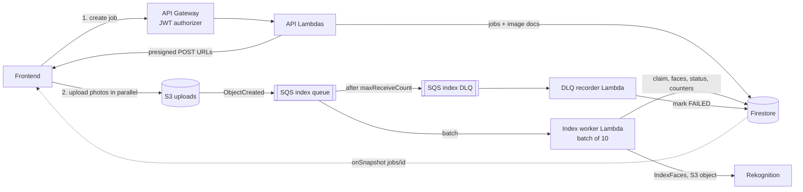
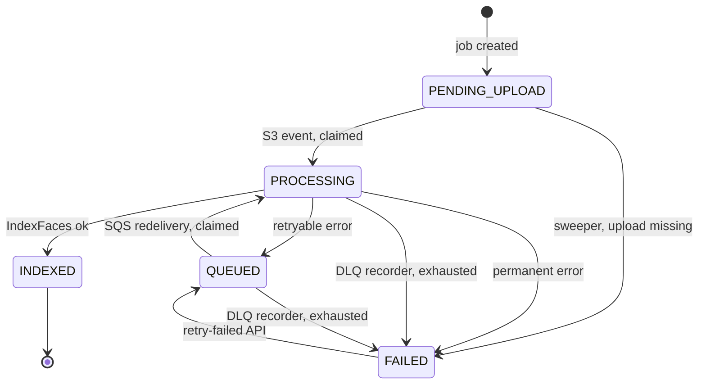

# Serverless refactor plan (AWS)

Move the Ktor server to S3, SQS, Lambda and Rekognition, with Firestore as the source of truth for results and progress. This document is a plan only. No code has changed.

Scope in order of priority:

1. Face indexing pipeline: S3 upload, SQS, batched Lambda, Rekognition `IndexFaces`.
2. Failure handling: classified errors, SQS retries, a dead-letter queue, and a way to retry failed images.
3. Categorize as a job instead of an SSE stream.
4. Move the remaining endpoints (collections, billing, webhooks) to Lambda.

## 1. Goals and non-goals

Goals:

- Billed time goes to work, not waiting. No `delay()` rate-limit sleeps, no open SSE connection, no per-person Firestore round trips.
- Every uploaded image ends in exactly one terminal state (`INDEXED` or `FAILED`) that the user can see, and failed images can be retried.
- A Lambda invocation handles a batch of up to 10 images and makes a fixed, small number of Firestore round trips regardless of batch size.
- Rekognition request rate stays under the account quota by configuration, not by sleeping.

Non-goals (for now):

- Changing the clustering algorithm beyond what categorize needs to read from Firestore instead of `ListFaces`.
- Replacing Firestore or Firebase Auth.
- Multi-region.

## 2. Target architecture



Request flow for an upload:

1. Frontend resizes photos in the browser (JPEG, long edge about 1600 px, under 5 MB) and calls `POST /collections/{collectionId}/jobs` with the file list.
2. The API Lambda checks ownership and subscription, creates `jobs/{jobId}` and one `images/{imageId}` document per file, and returns presigned POST data for each.
3. The frontend uploads directly to S3 and watches `jobs/{jobId}` with `onSnapshot`.
4. S3 emits one `ObjectCreated` event per photo into the index queue.
5. The index worker pulls up to 10 messages at a time, indexes them, and writes results.
6. Messages that exhaust their retries land in the DLQ. A recorder Lambda marks those images `FAILED` so the job can finish.
7. The user can call `POST /jobs/{jobId}/retry-failed` to re-queue failed images that can plausibly succeed.

## 3. Components

### 3.1 S3 bucket

- One bucket per environment, public access blocked.
- Key layout: `uploads/{collectionId}/{jobId}/{imageId}` (no filename in the key).
- Server-generated keys only. Presigned POST with a `content-length-range` condition (the 5 MB Rekognition limit), a fixed `key`, `Content-Type` of `image/jpeg`, 15 minute expiry.
- CORS allows POST from the frontend origin.
- Lifecycle rule expires `uploads/` after a configurable number of days (default 7). Photos are only needed until indexing finishes and any retry window closes.
- Event notification: `s3:ObjectCreated:*` on prefix `uploads/` to the index queue.

### 3.2 SQS

Index queue (standard; S3 cannot publish to FIFO):

| Setting | Value | Why |
|---|---|---|
| Visibility timeout | 6 x worker timeout | AWS guidance for Lambda event sources |
| Redrive policy | `maxReceiveCount` 5, dead-letter queue | Bounded retries |
| Message retention | 4 days (default) | Covers a long outage |

Index DLQ: retention 14 days, alarm on any message that stays longer than a few minutes, since the recorder normally drains it immediately.

Two message shapes are accepted by the worker:

- S3 event notification (normal path). Parse the key, skip `s3:TestEvent`, URL-decode the key (spaces arrive as `+`).
- Internal retry message `{ "type": "INDEX", "jobId": "...", "imageId": "..." }` sent by the retry API.

Categorize gets its own queue and DLQ later (section 8) so the two workloads have separate concurrency caps.

### 3.3 Index worker Lambda

Event source mapping:

| Setting | Value | Notes |
|---|---|---|
| `BatchSize` | 10 | Maximum for a standard queue without a long window |
| `MaximumBatchingWindowInSeconds` | 5 | Fills batches during large uploads; adds up to 5 s to the tail of a small upload |
| `FunctionResponseTypes` | `ReportBatchItemFailures` | Retry only the failed messages |
| `ScalingConfig.MaximumConcurrency` | derived from quota, see 3.7 | Do not use reserved concurrency for this; throttled invocations burn `maxReceiveCount` |

Function: 1024 MB, timeout 60 s, SnapStart enabled, role limited to the bucket prefix, the Rekognition collections, the queue, and the Firebase secret.

Per-invocation algorithm (the batch is up to 10 messages):

1. Parse messages into image references. Unknown keys, or keys with no matching image document: log, acknowledge, move on.
2. One Firestore transaction: read all image documents and the job documents involved, decide per image (section 4.2), write `PROCESSING` plus a lease for the ones to run.
3. Run `IndexFaces` for the claimed images concurrently with a semaphore of 5 (section 3.7). Image is passed as an S3 object, so no bytes pass through the Lambda.
4. Classify each result (section 5).
5. One Firestore transaction: write the result for every image (faces and `INDEXED`, or `FAILED`, or back to `QUEUED` with the error recorded) and apply the counter deltas to each affected job document.
6. For retryable failures, change the message visibility to a backoff (section 5.3) and report the message in `batchItemFailures`.

That is two Firestore transactions per invocation (claim and results), however many images are in the batch, instead of one write per face.

### 3.4 DLQ recorder Lambda

Triggered by the index DLQ (batch size 10). For each message: in a transaction, if the image is not `INDEXED` and not already `FAILED`, set `FAILED` with `failureKind = EXHAUSTED`, keep `lastError` from the last attempt, and apply the job counter delta. Then delete the message by returning success.

The S3 object is still present (the lifecycle rule has not expired it), so the DLQ message itself has no further value. The retry API re-creates work from the image document and S3.

### 3.5 Sweeper Lambda

Runs on an EventBridge schedule (every 15 minutes). It handles states that no queue message will ever resolve:

- `PENDING_UPLOAD` older than the upload expiry (default 1 hour): mark `FAILED` with `failureKind = UPLOAD_MISSING`.
- `QUEUED` older than a threshold with no recent attempt (for example the retry API changed state but the `SendMessageBatch` call failed): re-send the internal message.
- Jobs still `RUNNING` whose counters now add up: close them (safety net for a lost counter update).

### 3.6 API Lambdas

- API Gateway HTTP API with a JWT authorizer (issuer `https://securetoken.google.com/<firebase-project-id>`, audience the project id). Handlers receive a verified `uid`. This replaces `requireUid` and `FirebaseAuthService` on routes behind the gateway.
- New routes: `POST /collections/{id}/jobs`, `POST /jobs/{jobId}/retry-failed`, `POST /collections/{id}/categorize`.
- Existing routes move over in phase 4. The Stripe webhook route has no authorizer and verifies the signature itself.
- Handlers are plain `RequestHandler` classes. Netty and Ktor are removed from the Lambda artifacts.

### 3.7 Rate limiting against Rekognition

Find the `IndexFaces` TPS quota `Q` for the region in Service Quotas, and request an increase if needed. Then:

```
calls/s  ~=  MaximumConcurrency x in-flight calls per invocation / call latency
```

Pick `MaximumConcurrency` (C) and the per-invocation semaphore (L = 5) so that `C x L / latency` stays at about 70% of `Q`. For example `Q = 50`, latency 0.7 s, L = 5 gives C of at most 4. Measure real latency in the first load test and adjust. Treat `ThrottlingException` as a normal retryable error (section 5), not as a sign the configuration is wrong, unless it is frequent.

## 4. Firestore data model

### 4.1 Collections

```
collections/{collectionId}                  existing: ownerId, displayName, createdAt
collections/{collectionId}/images/{imageId} one document per photo (new)
jobs/{jobId}                                one document per upload or categorize run (new)
categorizations/{docId}                     existing result documents
billingProfiles, accounts                   unchanged
```

`jobs/{jobId}` for an index job:

| Field | Notes |
|---|---|
| `type` | `INDEX` or `CATEGORIZE` |
| `ownerId`, `collectionId` | For rules and queries |
| `status` | `RUNNING`, `COMPLETED`, `COMPLETED_WITH_ERRORS`, `FAILED` |
| `total`, `indexed`, `failed` | Counters. Pending is `total - indexed - failed` |
| `createdAt`, `updatedAt` | Server timestamps |
| `expiresAt` | Upload deadline used by the sweeper |

A job is complete when `indexed + failed == total`. Status becomes `COMPLETED` if `failed == 0`, otherwise `COMPLETED_WITH_ERRORS`. A categorize job uses the same document with `processed`, `total`, and `resultId` instead.

`collections/{collectionId}/images/{imageId}`:

| Field | Notes |
|---|---|
| `jobId`, `ownerId` | Link back to the job, for rules |
| `filename` | Original name. Not used as the Rekognition external id |
| `s3Key` | Server-generated key |
| `status` | `PENDING_UPLOAD`, `QUEUED`, `PROCESSING`, `INDEXED`, `FAILED` |
| `failureKind` | `PERMANENT`, `EXHAUSTED`, `UPLOAD_MISSING` when `FAILED` |
| `attempts` | Incremented on each claim |
| `leaseUntil` | Set while `PROCESSING` |
| `lastError` | `{ code, message, at }` from the last failed attempt |
| `faces` | Array of `{ faceId, confidence, boundingBox, poseDistance }` when `INDEXED` |
| `indexedAt` | Server timestamp |

Faces live inside the image document. That makes indexing one write per image, lets categorize read all faces with a single query per collection, and removes the `faceDetails` writes and the `getFaceForThumbnail` query.

The Rekognition `ExternalImageId` is the `imageId` (a UUID). This fixes two existing problems: Rekognition only accepts `[a-zA-Z0-9_.\-:]` there, and filenames collide across folders.

### 4.2 Image state machine



Claim rules inside the claim transaction:

| Current state | Action |
|---|---|
| `INDEXED` | Acknowledge the message (duplicate delivery) |
| `PENDING_UPLOAD`, `QUEUED` | Claim: set `PROCESSING`, `attempts += 1`, `leaseUntil = now + timeout + margin` |
| `PROCESSING`, lease still valid | Another invocation may be running. Report the message as failed so it returns later |
| `PROCESSING`, lease expired | The previous invocation died. Claim again |
| `FAILED` | Acknowledge unless the message is an internal retry message |
| Missing | Log and acknowledge |

Counter deltas are applied only at transitions between non-terminal and terminal states, computed in one helper so that no path can double count:

- Into `INDEXED`: `indexed += 1`
- Into `FAILED`: `failed += 1`
- `FAILED` to `QUEUED`: `failed -= 1`

### 4.3 Known gap: duplicate faces after a crash

`IndexFaces` is not idempotent. If an invocation dies after Rekognition indexed the faces and before the result is written, the retry indexes the photo again and leaves orphan faces in the Rekognition collection. The plan accepts this because Firestore is the source of truth:

- Categorize builds its list of faces from the Firestore `faces` arrays, never from `ListFaces`.
- `SearchFaces` matches that are not in the known face set are ignored.
- Orphans cost a negligible storage fee and disappear when the collection is deleted.

### 4.4 Counter contention

Each invocation updates its job document once, inside the result transaction. With `MaximumConcurrency` of about 4 and one write per invocation, that is a few writes per second to one document, near Firestore's sustained single-document limit. Firestore retries aborted transactions, and the writes are idempotent per image, so this is acceptable to start. If load tests show contention, switch to sharded counters (`jobs/{jobId}/shards/{n}`) and sum them in the client. The sweeper and the retry API reconcile counters from a `count()` aggregation over the images, so a drifting counter is self-correcting.

### 4.5 Security rules and indexes

- Rules: owners can read `collections`, `images`, `jobs`, `categorizations` where `ownerId == request.auth.uid`; `billingProfiles` is read-only for the owner. All writes come from the backend (Admin SDK bypasses rules).
- Composite index: `images` on `jobId` + `status` (retry API and job views). Categorize reads `status == INDEXED` within one collection, which needs no composite index.

## 5. Error handling and retries

### 5.1 Classification

Every failure in the worker is classified before anything is written.

| Class | Examples | Action |
|---|---|---|
| Success, no faces | Image has no detectable faces | `INDEXED` with an empty `faces` array. Not an error |
| Permanent | `InvalidImageFormatException`, `ImageTooLargeException`, `InvalidS3ObjectException` for a missing key, `ResourceNotFoundException` (collection deleted), `InvalidParameterException` | `FAILED`, `failureKind = PERMANENT`, record `lastError`, acknowledge. Never retried automatically |
| Retryable | `ThrottlingException`, `ProvisionedThroughputExceededException`, `InternalServerError`, `ServiceUnavailable`, timeouts, network errors, transient Firestore errors (`UNAVAILABLE`, `DEADLINE_EXCEEDED`, `ABORTED`) | Back to `QUEUED`, record `lastError`, report in `batchItemFailures` |
| Unknown | Anything unmapped | Treat as retryable. The DLQ bounds the damage |

The classifier is a pure function with a table-driven unit test. This is the piece most worth testing well.

### 5.2 Layers of retry

1. **SDK retries** inside one call: a small number of attempts with exponential backoff. Kept low so one slow call does not eat the invocation timeout.
2. **Message retries** via SQS: up to `maxReceiveCount` (5) deliveries per image.
3. **DLQ recorder**: after the last delivery the image becomes `FAILED` / `EXHAUSTED`, so the job finishes instead of hanging.
4. **User or operator retry**: `POST /jobs/{jobId}/retry-failed` for images that failed for reasons that may have passed.

### 5.3 Backoff

SQS has no exponential backoff. By default a failed message reappears when its visibility timeout runs out. For retryable failures the worker calls `ChangeMessageVisibility` with a delay that grows with `ApproximateReceiveCount` (roughly 15 s, 30 s, 60 s, 120 s, with jitter) before reporting the message as failed. The delay has to be shorter than the remaining visibility timeout.

### 5.4 Retry API

`POST /jobs/{jobId}/retry-failed`:

1. Check the job belongs to the caller and the subscription is active.
2. Select images with `status == FAILED` and `failureKind == EXHAUSTED` by default. `PERMANENT` failures are skipped unless the client passes `includePermanent: true`, because retrying a corrupt image only wastes Rekognition quota.
3. In a transaction, set them to `QUEUED`, reset `attempts`, subtract them from `failed`, and set the job back to `RUNNING`.
4. Send internal messages with `SendMessageBatch` (10 per call). Photos whose S3 object has expired are marked `FAILED` / `UPLOAD_MISSING` and the response tells the client to re-upload them.
5. If a send fails after the state change, the sweeper re-sends (section 3.5).

### 5.5 Observability

Structured logs with `jobId`, `imageId`, `attempt`, and `errorClass` on every image. CloudWatch alarms:

- Index DLQ age or depth.
- `ApproximateAgeOfOldestMessage` on the index queue (consumers stalled).
- Index worker errors and throttles.
- Rekognition throttled-request metric (signal to lower `MaximumConcurrency` or request a higher quota).

## 6. Frontend contract

- `POST /collections/{id}/jobs` returns `{ jobId, images: [{ imageId, filename, uploadUrl, fields }] }` (a page of up to 500 files; larger uploads use several jobs).
- The frontend uploads in parallel (6 to 10 at a time) and shows progress from `jobs/{jobId}` via `onSnapshot`.
- Failed images are listed from `images` where `jobId == X` and `status == FAILED`, with `lastError.code` mapped to a readable message.
- Results use `imageId`. Responses that today return filenames (people's `images` and the thumbnail's `imageFilename`) also include `filename` from the image documents, so the frontend can match its local files.
- Photos must be resized before upload. This also keeps every request under the Rekognition size limit.

## 7. Repository changes

| Today | Change |
|---|---|
| `Routing.kt` | Split into handlers. `/indexFaces` is replaced by the job routes. Keep it until cutover |
| `RekognitionService.indexFaces(bytes, filename, ...)` | Takes an S3 object reference and the `imageId`. Returns faces with pose. No Firestore access |
| `FirestoreService.saveFaceDetails` | Removed (also contains a no-op `firestore.batch().commit()`) |
| `FirestoreService.assignFaceDetailsToPerson`, `getFaceForThumbnail` | Removed. Thumbnail choice moves in memory |
| `CategorizePhotosUseCase` | Reads faces from Firestore, not `ListFaces`. Rate limiting by queue concurrency, not `delay()` |
| `RekognitionService.listCollections` | Replaced by counters on the collection document (see phase 5) |
| `StripeParamsProvider` | Fetch at init with a TTL re-check. The background refresh coroutine does not survive Lambda freezes |
| `FirebaseAdminSdkProvider` | Keep (Secrets Manager). Cache across warm invocations |
| `build.gradle.kts` | Multi-module: `core` (models, Firestore, Rekognition), `api`, `index-worker`, `dlq-recorder`, `categorize-worker`, `sweeper`. Each module builds its own jar with only the dependencies it needs |
| New `infra/template.yaml` | AWS SAM template: bucket, queues, mappings, functions, schedule, alarms. Parameters for `uat` and `prod` |

## 8. Categorize as a job

- `POST /collections/{id}/categorize` creates `jobs/{jobId}` with `type = CATEGORIZE` and sends one message to the categorize queue. It returns 202 with the job id.
- The categorize worker (timeout up to 15 minutes, `MaximumConcurrency` 1 per job type to start) loads every `INDEXED` image's faces in one query. It runs the existing greedy clustering with `SearchFaces` at bounded concurrency, writes progress to the job document every couple of seconds (not per face), and writes the result when done.
- Set `maxFaces` and the match threshold explicitly on `SearchFaces`. The default of 10 matches truncates large clusters.
- The result is stored one document per person, not one document with all people, so a large library cannot hit the 1 MB document limit.
- Stripe usage is reported after the result is saved, using the result id as the idempotency key (as today).
- Time limit: if remaining time drops under about a minute, persist cluster state and re-enqueue a continuation message. This is only needed for very large collections.
- Its queue has its own DLQ, recorder and alarms, with the same retry layers as indexing. Failures set the job to `FAILED` with the error recorded.

## 9. Rollout

| Phase | Work | Done when |
|---|---|---|
| 0 | Quotas checked, SAM stack skeleton, S3 bucket and queues in `uat`, Firestore rules and indexes drafted, frontend resize shipped | `uat` stack deploys cleanly |
| 1 | Extract the `core` module. New `indexFaces` against S3 objects. Image and job models, state transition helper, classifier, unit tests | Tests pass, no behaviour change for users |
| 2 | Index pipeline in `uat`: job API, worker, DLQ recorder, sweeper, alarms. Frontend upload flow behind a flag. Old `/indexFaces` stays | 500-photo load test completes, failures retry and surface, no Rekognition throttling above target |
| 3 | Categorize job and worker. Backfill images documents for existing collections (section 10) | Categorize results match the old implementation on test collections |
| 4 | Move remaining routes to Lambda behind API Gateway, switch DNS, retire Elastic Beanstalk | Billing and webhook flows verified in `uat`, then `prod` |
| 5 | Frontend reads collections, results, state and billing status directly from Firestore. Remove those routes | Rules tested, endpoints removed |

Each phase deploys to `uat` first and goes to `prod` only after its exit check.

## 10. Migration of existing data

- Existing collections have faces in Rekognition with the filename as `ExternalImageId`, and poses in `faceDetails`. Write a one-off script that builds `collections/{id}/images/{imageId}` documents from `ListFaces` plus `faceDetails`, with `INDEXED` status, `legacy: true`, and the old external id in the face records. Categorize treats the face's `externalImageId` as the key and maps it back to a filename.
- Keep the old categorize read path until the backfill has run for all collections.
- Existing categorization results stay as they are.

## 11. Testing

- Unit: error classifier, state transition and counter delta helper, S3 event and internal message parsing (including the test event and URL-encoded keys).
- Firestore emulator: claim transaction behaviour (duplicate delivery, live lease, expired lease), job completion.
- Worker with a fake Rekognition client: batch of 10 with mixed success, permanent and retryable failures. Check the `batchItemFailures` response and that `INDEXED` messages are not redelivered.
- Integration in `uat`: upload with a few corrupt files and a throttled run. Check DLQ recording, `retry-failed`, and the sweeper.
- Load: 500 photos, watch Rekognition throttling, queue age, and job counter correctness.

## 12. Risks

| Risk | Mitigation |
|---|---|
| Rekognition `IndexFaces` quota is lower than expected | Check early. Lower `MaximumConcurrency`, or request an increase. The queue absorbs the wait |
| Job counter drift or contention | Single transition helper, sharded counters as fallback, reconciliation via `count()` in the sweeper |
| JVM cold starts on user-facing routes | SnapStart, split modules, and the JWT authorizer rejecting bad tokens before any Lambda starts |
| Crash between `IndexFaces` and result write leaves orphan faces | Firestore is the source of truth. Orphans are ignored and cleaned up with the collection |
| Photos stored in S3 (new for this product) | Short lifecycle, private bucket, short-lived presigned URLs, server-generated keys. Confirm retention with the product owner |
| Large categorize runs exceed 15 minutes | Continuation messages, and chunked fan-out if needed |

## 13. Open questions

- What is the `IndexFaces` TPS quota in the target region?
- Is storing user photos in S3 for a few days acceptable? What retention?
- Maximum photos per upload? (The plan assumes pages of up to 500.)
- Keep Kotlin on the JVM with SnapStart, or rewrite the Lambdas in another runtime for smaller cold starts?
- Should permanent failures ever be retryable from the UI (for example after a transient S3 permission problem)?
- Where do Firestore and the Firebase project live? Latency from Lambda to Firestore depends on it.
